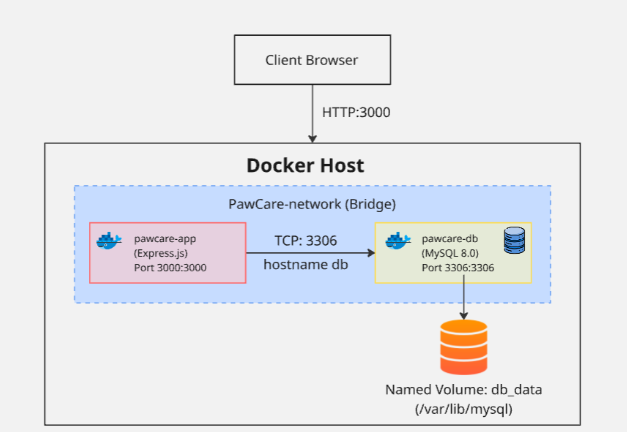
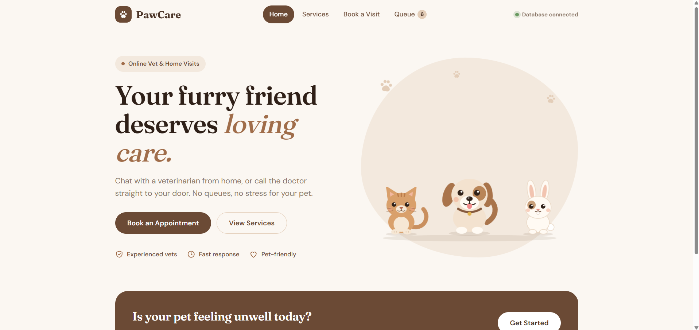
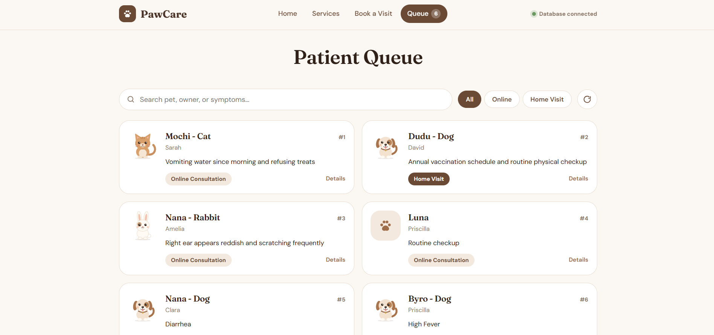
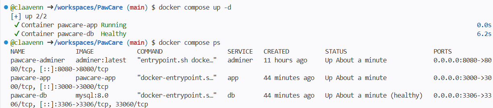

# PawCare: Multi-Tier Pet Tele-Triage & Home-Visit Platform

PawCare is a lightweight, responsive pet tele-triage and home-visit appointment platform designed to help pet owners schedule consultations and get early symptom screening when emergencies occur.

The entire system is fully containerized using **Docker** and orchestrated with **Docker Compose**, ensuring a reliable and reproducible environment that runs identically on any machine without setup friction.

## Project Overview & Motivation

Years ago, my dog suddenly fell ill late at night. I remember the sheer panic of not knowing what is wrong and what to do, whether it was an emergency, or where to find help at that hour. That helpless feeling stayed with me. Most pet owners still face this exact problem, relying on frantic late-night searches or unstructured messages. When it came time to build a project, I decided to create PawCare, a pet tele-triage and home-visit scheduling platform designed to give pet owners online consultation and quick guidance when they need it most. 

I built PawCare to address this challenge with an accessible triage flow and appointment queue. Beyond solving a real-world problem, this project demonstrates:
* Multi-tier containerization (Frontend, Backend, Database, and DB Admin tooling).
* Production-grade Docker practices (multi-stage builds, non-root runtimes, image optimization).
* Deterministic container orchestration with automated healthchecks, internal network isolation, and persistent volume lifecycles.

## System Architecture

PawCare runs on a multi-tier containerized architecture inside a user-defined bridge network (`pawcare-network`):

1. Frontend: Clean HTML/CSS/Vanilla JS interface for registering appointments and monitoring real-time queue status.

2. Backend (pawcare-app): Express.js REST API serving the web client, running triage business logic, and executing initial database seeding.

3. Database (pawcare-db): MySQL 8.0 relational database with stateful data mapped to a Docker named volume (db_data).

4. Database Admin Tool (pawcare-adminer): Lightweight web-based database management GUI isolated under the tools profile.

## Getting Started
Prerequisites
* Docker Engine (v20.10+)
* Docker Compose (v2.0+)

## Quick Start (Single Command)
1. clone the repository: 
git clone [https://github.com/claavenn/PawCare.git](https://github.com/claavenn/PawCare.git)
cd PawCare

2. Set up the environment configuration:
cp .env.example .env 

3. Build and start the application stack:
docker compose up -d --build

4. Access the application:
Open your browser and navigate to: http://localhost:3000
GitHub Codespaces: Go to the ports tab in your bottom terminal panel, find port '3000', and click the globe icon to open the website in your browser or use the auto-forwarded URL
Check container status: *docker compose ps*

## Advanced Operations
Running Database Management Tools (Adminer)
To inspect the MySQL database schema and records via Adminer without modifying standard production services:
*docker compose --profile tools up -d*

Access the Adminer web UI at http://localhost:8080:
System: MySQL
Server: db
Username: root
Password: pawcare_password (or value defined in your .env)
Database: pawcare_db

* Verifying API Health
curl -i http://localhost:3000/health

* Verifying Data Persistence
1. Add an appointment via the web UI at http://localhost:3000.
2. Stop and remove the active containers: *docker compose down*
3. Restart the stack: *docker compose up -d*
4. Refresh your browser; the appointment data remains intact because it is stored in the persistent named volume db_data. Note: Running docker compose down retains the volume. If you explicitly want to purge all stored records, run docker compose down -v.

## Screenshots
Application Interface & Live Queue

Container Status & Healthcheck (docker compose ps)

## Project Links
Technical Article (Medium / Blog): https://medium.com/@priscillaciella/building-pawcare-how-my-past-struggles-with-a-sick-dog-led-to-a-containerized-pet-app-98fe25d8e5be 
YouTube Video Demonstration: https://youtu.be/v-ju5mfzV18?si=W34fpK13X-JERK2f

## AI Usage Declaration
During the development of the PawCare project:
Generative AI Tools Used: Google Gemini & Claude.

Scope of Assistance:
1. Brainstorming architectural container patterns (multi-stage build pipeline, bridge networking, Docker Compose healthcheck configuration).
2. Debugging syntax errors in Express.js database connection routines.
3. Assisting in structuring technical documentation and article outlines.

Key prompts example used:
**Frontend Wireframe and Layouts:**
   -> "Bantu buatkan kerangka dasar untuk web PawCare: aplikasi tele-triage dan home-visit hewan. Saya ingin layout sederhana dengan navigasi tab antara Book Appointment dan Patient Queue, form input pasien yang rapi, serta layout kartu antrean untuk menampilkan data janji temu."

**Frontend UI Polish & Micro-Animations:**
    -> "Tambahkan styling CSS modern dan efek animasi halus (transisi kartu saat data dimuat dan feedback tombol saat ditekan) menggunakan CSS agar tampilan frontend PawCare terasa interaktif dan tidak kaku."

Verification: All Dockerfiles, compose specifications, backend routes, and database seeding implementations were independently reviewed, tested, modified, and validated within local and GitHub Codespaces environments.
